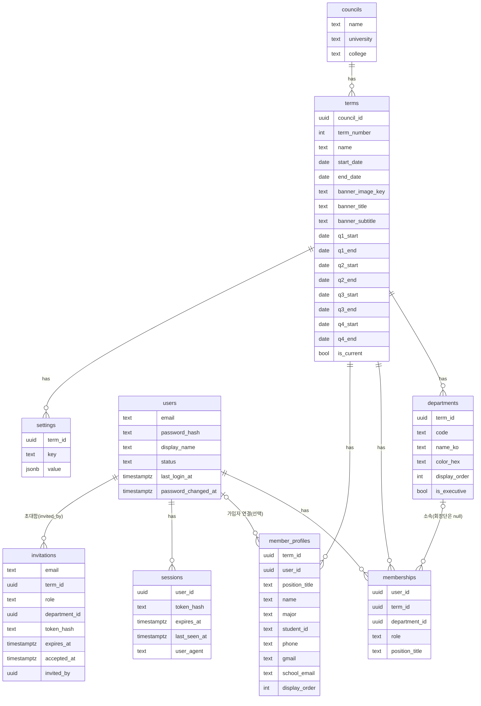
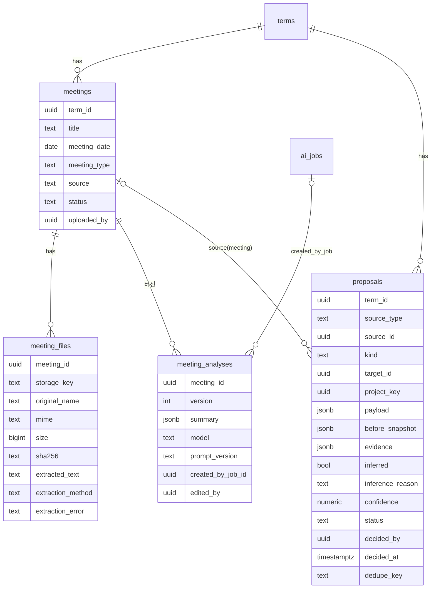
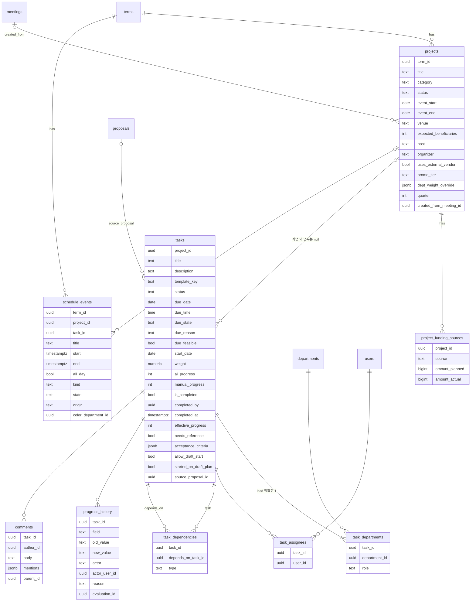
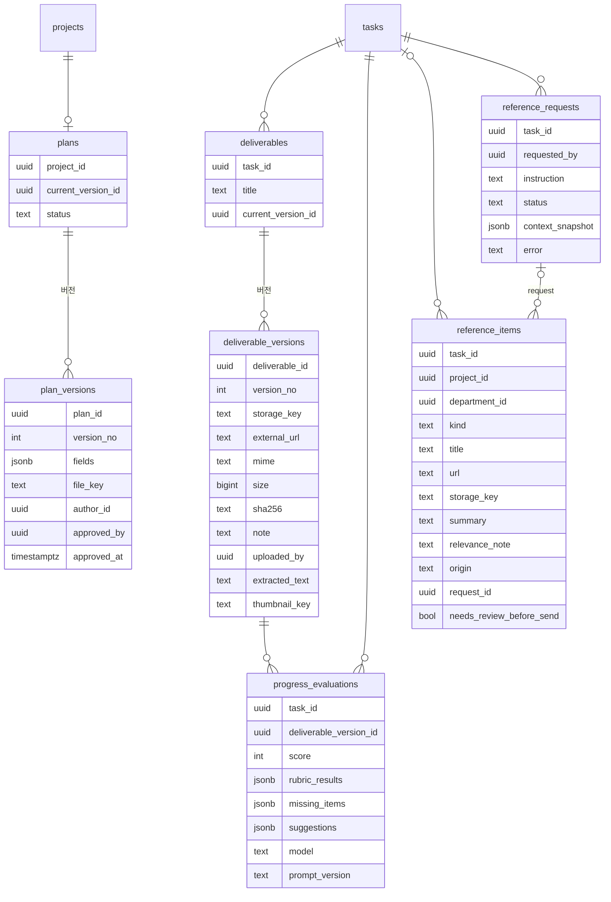
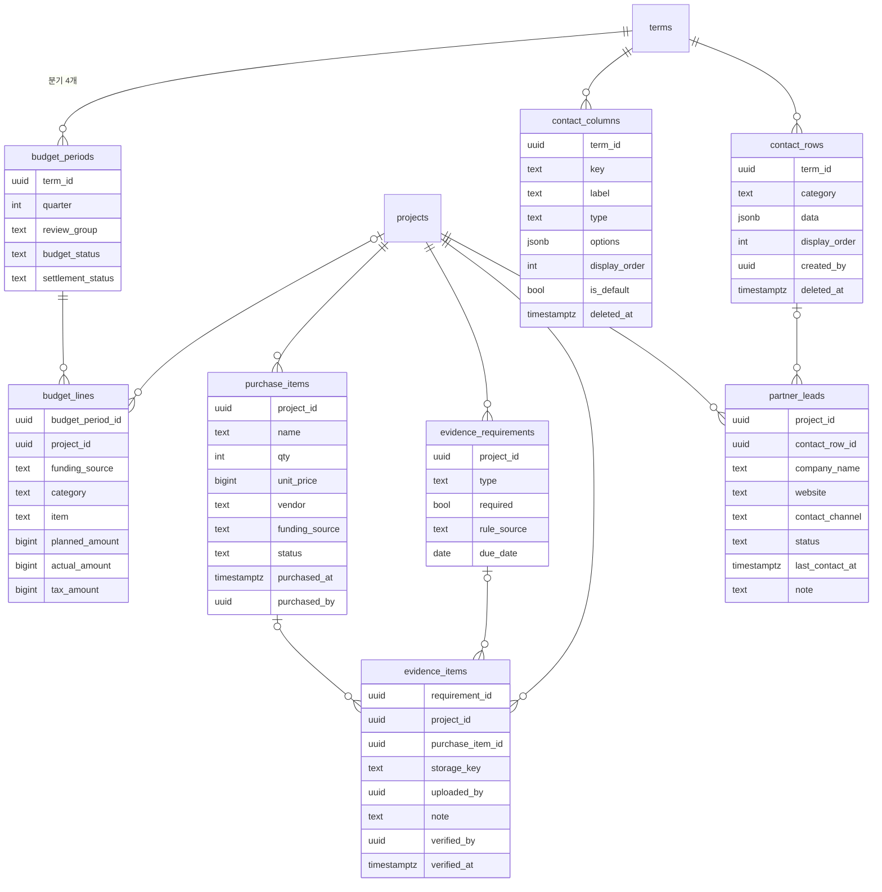
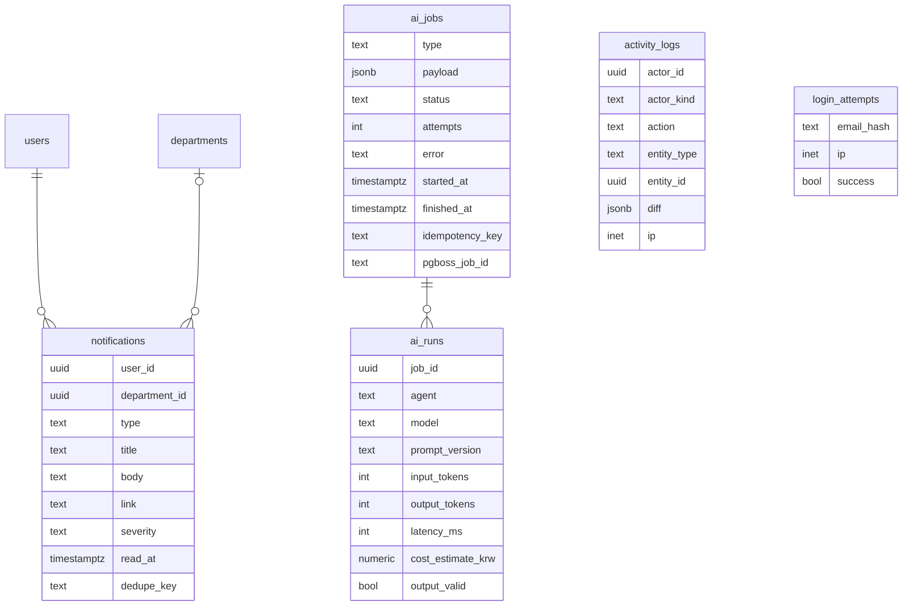

# KGB_Agent 데이터 모델 (Phase 0 확정안 — 승인 대기)

> 근거: 지시서 PART 4. 지시서 정의에서 **추가·변경한 부분은 🆕 / ✏️ 로 표시**하고 `docs/DECISIONS.md`의 ADR 번호를 단다.
> 표기: FK 삭제 정책 R=RESTRICT, C=CASCADE, N=SET NULL.

---

## 1. 공통 규칙

| 규칙 | 내용 |
|---|---|
| 기본키 | `id uuid` — UUID v7(애플리케이션 생성. Prisma `@default(uuid(7))` 지원 여부를 Phase 1에서 확인, 미지원 시 `uuidv7` 패키지) |
| 타임스탬프 | 모든 테이블 `created_at`, `updated_at` (`timestamptz`, UTC 저장) |
| 날짜 | 마감·행사일은 `date`(종일) + 선택 `due_time time`. 계산·표시는 `Asia/Seoul` |
| 소프트 삭제 | `projects`, `tasks`, `meetings`, `deliverables`, `deliverable_versions`, `contact_rows`, `contact_columns`, `member_profiles` → `deleted_at timestamptz null`. 기본 조회는 `deleted_at IS NULL` |
| 데모 구분 | 시드로 만드는 모든 행 `is_demo boolean default false`. 화면에 "데모 데이터" 배지 |
| 금액 | `bigint`(원 단위 정수). 앱에서는 `bigint` ↔ `number` 변환 헬퍼 사용(안전 범위 검사) |
| 열거형 | Postgres enum 대신 `text + CHECK` 제약(값 추가 시 마이그레이션이 가벼움) — ADR-006 |
| 감사 | 모든 쓰기 → `activity_logs` (서비스 계층에서 같은 트랜잭션) |

---

## 2. ERD

가독성을 위해 도메인별로 나눈다. 모든 테이블의 `id`, `created_at`, `updated_at`은 생략.

### 2-1. 조직·사용자·인증

### 2-2. 회의록·제안

### 2-3. 사업·업무·일정

### 2-4. 작업물·기획안·레퍼런스

### 2-5. 재정·연락망·제휴

### 2-6. 시스템

---

## 3. 테이블 정의 상세

지시서 4-2의 필드는 모두 포함한다. 아래에는 **값 도메인, 제약, 지시서 대비 추가·변경**만 적는다.

### 3-1. 조직·사용자

| 테이블 | 값 도메인·제약 | 추가·변경 |
|---|---|---|
| `terms` | `UNIQUE(council_id, term_number)`, 기수당 `is_current` 1개(부분 고유 인덱스), 분기 날짜는 q1_start ≤ q1_end < q2_start … 순서 CHECK | — |
| `departments` | `code ∈ {planning, finance, secretariat, promotion, operations, executive}`, `UNIQUE(term_id, code)`, `display_order` 기획1·재정2·사무3·홍보4·집행5·회장단 0 | 🆕 `executive`(회장단) 행, 🆕 `is_executive` — 학생회장 주관 업무(PRES_SUBMIT_SCHOOL 등)를 담기 위함. 국서 카드 5개에는 표시하지 않음 (ADR-011, 미결정 N3) |
| `users` | `status ∈ {invited, active, disabled}`, `email` 소문자 정규화 UNIQUE | 🆕 `password_changed_at` |
| `memberships` | `role ∈ {admin, president, vice_president, head, member}`, `UNIQUE(user_id, term_id)` | — |
| `member_profiles` | 개인정보 테이블. 로그·AI 입력 금지 대상 | — |
| 🆕 `sessions` | 토큰 원문은 쿠키에만, DB엔 SHA-256 해시. 유휴 7일 | ADR-004 |
| 🆕 `invitations` | 토큰 해시, 72시간 만료, 1회용 | ADR-004 |
| 🆕 `login_attempts` | 이메일은 해시로 저장(개인정보 최소화), 15분 창 5회 제한 | ADR-004 |
| `settings` | `UNIQUE(term_id, key)`. 키 목록은 §4. 변경 이력은 `activity_logs`(action=`settings.update`, diff에 전·후 값) | — |

### 3-2. 회의록·제안

| 테이블 | 값 도메인·제약 | 추가·변경 |
|---|---|---|
| `meetings` | `meeting_type ∈ {regular, extraordinary, department, other}`(정기/임시/국서/기타), `source ∈ {upload, paste, manual}`, `status ∈ {uploaded, extracting, extracted, analyzing, analyzed, reviewed, failed}` | — |
| `meeting_files` | `extraction_method ∈ {pdf_text, docx, hwpx, hwp_best_effort, plain, paste}` | 붙여넣기도 `meeting_files` 1행(storage_key null)로 저장해 추출 경로를 통일 |
| `meeting_analyses` | `UNIQUE(meeting_id, version)`. 사용자가 편집하면 새 version(`edited_by` 기록) | 🆕 `edited_by` |
| `proposals` | `source_type ∈ {meeting, manual, monitor}`, `kind ∈ {new_project, update_project, new_task, update_task, deadline, dependency, cancel}`, `status ∈ {pending, approved, edited_approved, rejected, superseded}`, `confidence` 0~1, `payload`는 kind별 zod 스키마, **`UNIQUE(dedupe_key) WHERE status='pending'`** | 🆕 `project_key` — 같은 회의록에서 나온 "신규 사업 제안"과 그 하위 업무 제안을 묶는 그룹 키(사업 승인 전에는 project_id가 없으므로) |

### 3-3. 사업·업무·일정

| 테이블 | 값 도메인·제약 | 추가·변경 |
|---|---|---|
| `projects` | `category ∈ {event, promotion, partnership, welfare, admin, other}`, `status ∈ {proposed, planning, approved, in_progress, done, cancelled, postponed}`, `quarter` 1~4(규칙 엔진 계산값 저장) | 🆕 `promo_tier ∈ {free, low, high} null` — 홍보 등급(PRO_TIER 결과, 일정 계산 입력) |
| `project_funding_sources` | `source ∈ {school, student_fee}`, `UNIQUE(project_id, source)` | — |
| `tasks` | `status ∈ {blocked, todo, in_progress, review, done, cancelled}`, `due_state ∈ {proposed, confirmed}`, `ai_progress`/`manual_progress` 0~100 CHECK, `weight > 0` | 🆕 `due_feasible` (infeasible 표시), 🆕 `allow_draft_start`(국장의 초안 기반 선착수 허용, 기본 false — Q7), `effective_progress` = **STORED 생성 컬럼**: `CASE WHEN is_completed THEN 100 ELSE COALESCE(manual_progress, ai_progress, 0) END` (ADR-007) |
| `task_departments` | `role ∈ {lead, support}`, `UNIQUE(task_id, department_id)`, **`UNIQUE(task_id) WHERE role='lead'`** + 서비스 계층에서 "정확히 1개" 검사(0개 방지는 트랜잭션 말미 검증) | — |
| `task_assignees` | `PRIMARY KEY(task_id, user_id)` | — |
| `task_dependencies` | `type ∈ {finish_to_start, approval_required, draft_ok}`, `UNIQUE(task_id, depends_on_task_id)`, `CHECK(task_id <> depends_on_task_id)`, 삽입 시 순환 검사(재귀 CTE, 서비스 계층 + 직렬화 잠금) | — |
| `progress_history` | `field ∈ {ai, manual, completed}`, `actor ∈ {user, ai}` | ✏️ 지시서의 `actor(user_id 또는 'ai')`를 `actor`(종류) + `actor_user_id`(FK) 두 컬럼으로 분리 — FK 무결성 확보 |
| 🆕 `comments` | 업무 드로어 코멘트 스레드(지시서 8-7), `mentions`(user_id 배열) → 알림 | 지시서 PART 4에 누락된 테이블 (ADR-013) |
| `schedule_events` | `kind ∈ {event_day, deadline, milestone, meeting, custom}`, `state ∈ {proposed, confirmed}`, `origin ∈ {ai, user, rule}` | ✏️ **업무 마감과 사업 행사일은 이 테이블에 복제하지 않는다.** 캘린더 피드 = `projects.event_start~end` + `tasks.due_date` + `schedule_events`(milestone/meeting/custom) + `pending proposals`의 마감 — 단일 원천(ADR-012). `event_day`/`deadline` kind는 사업·업무에 묶이지 않은 사용자 일정용으로만 남긴다 |

### 3-4. 작업물·기획안·레퍼런스

| 테이블 | 값 도메인·제약 | 추가·변경 |
|---|---|---|
| `deliverable_versions` | `UNIQUE(deliverable_id, version_no)`, `storage_key` 또는 `external_url` 중 정확히 하나(CHECK) | — |
| `progress_evaluations` | `score` 1~100, `rubric_results` = `[{criterion, verdict: met|partial|unmet, reason}]` | — |
| `plans` | `status ∈ {draft, submitted, approved, rejected}`, 사업당 1개(`UNIQUE(project_id)`) | — |
| `plan_versions` | `fields` zod 스키마: 행사명, 일시, 장소, 예산액, 주최, 주관(D17), 배경 및 목적, 행사내용, 타임테이블[], 예산 시나리오[] | — |
| ✏️ `reference_items` | `kind ∈ {link, file, ai_example}`, `origin ∈ {user, ai_search, ai_generated}` | 지시서의 `references`는 SQL 예약어라 물리 테이블명만 `reference_items`로 변경, 의미 동일 (ADR-008). 🆕 `needs_review_before_send`(외부 발송용 문안 표시) |
| `reference_requests` | `status ∈ {queued, running, done, failed}`, `context_snapshot` = `{meeting_analysis_ids[], plan_version_id, plan_is_draft, past_deliverable_ids[]}` | — |

### 3-5. 재정·연락망·제휴

| 테이블 | 값 도메인·제약 | 추가·변경 |
|---|---|---|
| `budget_periods` | `UNIQUE(term_id, quarter)`, `review_group` = quarter∈{1,2}→`A`, {3,4}→`B` (규칙 엔진 계산) | — |
| `budget_lines` | `funding_source ∈ {school, student_fee} null`(null이면 경고), `tax_amount` = 교비면 `round(actual_or_planned × SCHOOL_TAX_RATE)`(규칙 엔진) | — |
| `purchase_items` | `status ∈ {listed, approved, purchased, cancelled}`, 재원 null 허용(저장 + 경고) | — |
| `evidence_requirements` | `type ∈ {receipt, photo, beneficiary_roster, official_letter, plan_doc, quote, transfer_record, other}`, `rule_source` = 규칙 코드(예: `FEE_ROSTER_LE_100`) | — |
| `contact_columns` | `type ∈ {text, phone, email, url, select}`, 기본 열 8개(`is_default`), 열 삭제 = `deleted_at` 설정 → 30일 후 정리 작업이 `contact_rows.data`의 해당 key 제거 | 🆕 `options`(select 선택지), 🆕 `deleted_at` |
| `contact_rows` | `data` JSONB `{column_key: value}`, `category`는 편집 가능한 문자열(기본: 학교 관계자/제휴업체/대행사/푸드트럭/기타) | — |
| `partner_leads` | `status ∈ {candidate, contacted, replied, negotiating, confirmed, declined}` | — |

### 3-6. 시스템

| 테이블 | 값 도메인·제약 | 추가·변경 |
|---|---|---|
| `notifications` | `severity ∈ {info, warn, critical}`, `UNIQUE(user_id, dedupe_key)` — dedupe_key에 날짜·등급 포함(`<규칙>:<대상>:<등급>:<YYYY-MM-DD>`)으로 하루 1회 & 등급 상승 시 새 알림 | — |
| `activity_logs` | `actor_kind ∈ {user, ai, system}`, `diff`는 마스킹 함수 통과 필수 | ✏️ `actor_id`(user FK, null 허용) + `actor_kind` 분리 |
| `ai_jobs` | `type ∈ {extract, analyze_meeting, propose_work, schedule, finance_rules, evaluate, reference, monitor, weekly_summary}`, `status ∈ {queued, running, succeeded, failed, waiting_budget}`, `UNIQUE(idempotency_key)` | 🆕 `pgboss_job_id` (ADR-005) |
| `ai_runs` | 비용 추정은 원화(`cost_estimate_krw`) — 일 예산 비교용 | — |

---

## 4. `settings` 키 (지시서 5-7 + 누락 보완)

| 키 | 기본값 | 비고 |
|---|---|---|
| `SCHOOL_SUBMIT_LEAD_DAYS` | 21 | |
| `VENDOR_CONFIRM_BUFFER_DAYS` | 7 | |
| `SCHOOL_TAX_RATE` | 0.10 | |
| `ROSTER_THRESHOLD` | 100 | 수혜 ≤ 값이면 명단 필수 (D15) |
| `PROMO_HIGH_COST_AMOUNT` | 300000 | |
| `PROMO_HIGH_QTY` | 300 | |
| `PROMO_PUBLISH_LATEST_DAYS` | 7 | |
| `OPS_MANUAL_LATEST_DAYS` | 7 | |
| `PURCHASE_LATEST_DAYS` | 3 | |
| `EVIDENCE_PHOTO_GRACE_DAYS` | 1 | |
| `DEFAULT_DURATIONS` | 지시서 5-2 표 | `{key: {default, min}}` — 🆕 `min`(infeasible 대안 (a) "최소 소요일까지 압축"에 필요, 지시서에 값 없음 → 기본 `ceil(default/2)`, 미결정 N6) |
| `PROMO_DURATIONS` | 무비용 3 / 저비용 4+3 / 고비용 7+10 | |
| `HOLIDAYS` | 대한민국 공휴일(대체공휴일 포함) + 학사 휴일 | 시드 후 사용자 확인 필요 |
| 🆕 `STALL_DAYS` | 3 | 지시서 6-2 A7에만 언급 |
| 🆕 `AI_DAILY_BUDGET_KRW` | staging 3000 | Q9 |
| 🆕 `UPLOAD_MAX_MB` | 50 | 10-3 |
| 🆕 `MEMBER_CAN_UPLOAD_MINUTES` | false | Q4 |
| 🆕 `FINANCE_COLOR_HEX` | `#8EC5E4` | Q1, 변경 가능한 유일한 국서 색 |

---

## 5. 무결성 규칙 구현 위치

| 규칙 | DB | 애플리케이션 |
|---|---|---|
| 업무당 lead 정확히 1 | 부분 고유 인덱스(≤1) | 트랜잭션 말미 검사(=1) |
| 의존 순환 금지 | 자기참조 CHECK | 재귀 CTE 순환 검사 + 사업 단위 advisory lock |
| effective_progress 공식 | 생성 컬럼(직접 수정 불가) | `@kgb/rules.effectiveProgress()` 동일 공식, 일치 테스트 |
| 사업 취소 연쇄 | — | 서비스: 미완료 업무 `cancelled`, 증빙 보존, 캘린더 취소선(사업 status로 판단, 삭제 없음) |
| 제안 중복 | `UNIQUE(dedupe_key) WHERE status='pending'` | dedupe_key 계산 함수 |
| 알림 중복 | `UNIQUE(user_id, dedupe_key)` | `INSERT … ON CONFLICT DO NOTHING` |
| 마이그레이션 | 모든 마이그레이션에 down 스크립트(`prisma/migrations/*/down.sql`) 작성 | 운영 DB 파괴적 변경 자동 실행 금지 |
