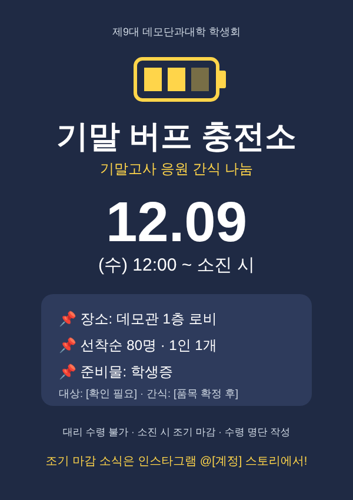

# A5 레퍼런스·예시안 — 실제 모델 점검 (2026-10-31)

- 모델: claude-opus-5-5 (웹 검색: web_search 서버 도구)
- 프롬프트: a5-v1

## 홍보국 — 홍보물 제작(지시 포함) (111.5초)

- 지시: 인스타그램 카드뉴스 5장 이내, 20대 대학생 감성으로
- 결과: succeeded, 웹 검색 4회, 출처 20개 중 8개 선별
- 사용한 기획안: v1 결재본
- 메모: 기획안 v1(결재본)의 일시·장소·인원(12/09 수 12:00~소진 시, 데모관 1층 로비, 선착순 80명)과 검색 결과 S2·S5·S8·S11·S13·S15·S18·S20을 사용했습니다. 조사 메모 B에 나온 툴디·누구나HRD 자료와 인스타그램 이미지 규격 내용은 S 목록에 출처가 없어 인용하지 않았으니, 규격은 인스타그램 공식 도움말에서 다시 확인하세요. 간식 품목, 대상(학생회비 납부자 한정 여부), 모바일 학생증 인정 여부, 꾸러미 이름, 인스타그램 계정, 포스터 인쇄 여부는 미정이라 [ ]로 비워 두었습니다.

### 검색 레퍼런스 8건

- [SNS 카드뉴스를 만들 때 알아야할 디자인 팁 5가지 - 크몽](https://kmong.com/article/1013--SNS-%EC%B9%B4%EB%93%9C%EB%89%B4%EC%8A%A4%EB%A5%BC-%EB%A7%8C%EB%93%A4-%EB%95%8C-%EC%95%8C%EC%95%84%EC%95%BC%ED%95%A0-%EB%94%94%EC%9E%90%EC%9D%B8-%ED%8C%81-5%EA%B0%80%EC%A7%80)
  - 크몽의 SNS 카드뉴스 디자인 팁 글입니다. 표지 제목·부제의 중앙 배치와 큰 글자, 행동 유도 문구(CTA) 삽입 등 기본 원칙을 다룹니다.
  - 벤치마킹: 표지는 제목·부제를 중앙에 크게 배치한다 / 마지막 장에 저장·공유·친구 태그 같은 CTA를 넣는다 / 학생회 고유 색을 강조색으로 쓰고 색은 2~3가지로 통일한다
- [[보도] “중간고사 화이팅!” 총장·총학생회 간식 나눔 행사 < 보도 < 대학 < 동대신문 < 기사본문 - 동국대학교 대학미디어센터](https://www.donggukmedia.com/news/articleView.html?idxno=83767)
  - 동국대 대학미디어센터의 중간고사 간식 나눔 보도입니다. 총장·총학생회가 공동으로 간식을 배부했고 짧은 시간에 전량 소진된 결과를 다뤘습니다.
  - 벤치마킹: 빠른 소진 기록을 홍보 문구로 쓰면 조기 방문을 유도할 수 있다(단, 우리 학생회의 실제 기록이 있을 때만 쓴다) / 행사 후 결과 보도·후기를 남겨 다음 행사 홍보에 재활용한다
- [시험기간 응원 이벤트 : UNIST 학부 총학생회](https://unistusc.org/usdc_notice/?bmode=view&idx=24336127)
  - UNIST 학부 총학생회의 시험기간 응원 이벤트 공지입니다. 간식과 함께 응원 방명록을 두었고, 이모지와 친근한 말투를 썼습니다.
  - 벤치마킹: 20대 감성에 맞는 친근한 구어체와 적당한 이모지를 쓴다 / 현장 응원 메시지 보드를 두면 행사 후 후기 게시물 소재가 생긴다
- [신라대, 간식 나눔 행사 '화랑's 힐링박스'로 따뜻한 캠퍼스 응원 문화 조성 < 대학핫뉴스-일반대 < 대학·교육 < 기사본문 - 교수신문](https://www.kyosu.net/news/articleView.html?idxno=204182)
  - 신라대가 간식 꾸러미에 '힐링박스'라는 이름을 붙여 진행한 시험기간 응원 행사 기사입니다.
  - 벤치마킹: 꾸러미에 이름을 붙여 기억에 남게 하고 표지 제목으로 활용한다 / 행사를 '응원 문화'로 포지셔닝해 학생회 홍보 효과를 낸다
- [[문화·복지] 2024-1 기말고사 간식행사 안내](https://cms.kookmin.ac.kr/kmustudentcouncil/community/business-all001.do?mode=view&articleNo=5918172&article.offset=0&articleLimit=10)
  - 국민대 총학생회의 2024-1학기 기말고사 간식행사 공지입니다. 온라인·오프라인 참여 방법이 나뉘어 있어서 상세 방법은 카드뉴스로 안내하고, 본문 공지와 역할을 나눴습니다.
  - 벤치마킹: 카드에는 핵심만 넣고 긴 설명은 캡션이나 본문으로 넘긴다 / 참여 절차가 있으면 '참여 방법'을 별도 카드 한 장으로 분리한다
- [2025-2학기 기말시험 간식행사 안내 : 연세대학교 대학원 총학생회](https://ysgsa.yonsei.ac.kr/notice1/?bmode=view&idx=168932938)
  - 연세대 일반대학원 총학생회의 2025-2학기 기말시험 간식행사 안내입니다. 우리 행사와 같은 12월 시기이며, 필수 정보를 기호로 목록화하고 선착순 인원, 준비물(학생증, 모바일 가능), 조기 마감 시 SNS 안내 방침을 적었습니다.
  - 벤치마킹: 일시·장소·대상·준비물을 📌 같은 기호로 목록화해 한눈에 보이게 한다 / 선착순 인원을 숫자로 명확히 적는다 / 조기 마감은 인스타그램(스토리)으로 알린다고 미리 고지해 팔로우를 유도한다 / 준비물(학생증)과 모바일 학생증 인정 여부를 함께 적는다
- [공지사항 - 인사캠 게시판읽기 ( [ 2024학년도 2학기 중간고사 간식배부 안내 ] )](https://student.skku.edu/student/notice2.do?mode=view&articleNo=51193&article.offset=0&articleLimit=9)
  - 성균관대 인사캠의 2024-2학기 중간고사 간식배부 안내입니다. 계절감 있는 도입 문장, 협찬사와 함께한 SNS 댓글 이벤트, 봉투 미제공 안내(개인 가방 지참)가 특징입니다.
  - 벤치마킹: 첫 문장에 계절감을 넣는다(12월이므로 겨울·연말·종강 분위기) / 현장에서 혼선이 생길 수 있는 준비물·포장 여부를 미리 알린다 / 댓글 이벤트 같은 온라인 참여 장치로 게시물 반응을 늘린다
- [공지사항 - 자과캠 게시판읽기 ( [ 2026 - 1학기 중간고사 응원 간식 배부 ] )](https://student.skku.edu/student/notice3.do?mode=view&articleNo=63450&article.offset=0&articleLimit=9)
  - 성균관대 자과캠 총학생회의 2026-1학기 중간고사 응원 간식 배부 공지입니다. 일시와 '소진 시까지' 운영 방식, 간식 브랜드·수량, 1인 1회와 조기 마감 같은 유의사항을 짧게 안내했습니다.
  - 벤치마킹: 간식 품목과 수량을 크게 보여 줘 기대감과 선착순 긴박감을 만든다 / 유의사항은 1인 1회, 대리 수령 불가, 소진 시 마감 등 2~3줄로 짧게 정리한다 / '12:00 ~ 소진 시'처럼 종료 시각 대신 소진 기준을 명시한다

### 예시안 3건

#### 포스터 목업 (SVG) (포스터 목업, svg)



#### 포스터 카피·레이아웃 설명 — 현장 게시용 (포스터 카피·레이아웃, markdown)

```markdown
# 포스터 카피 & 레이아웃 (초안)

## 카피
- 헤드라인: **기말 버프 충전소 🔋**
- 서브헤드: 기말고사 응원 간식 나눔
- 바디 카피: 지친 학우님들, 간식 꾸러미 받고 마지막까지 달려요!
- 핵심 정보
  - 일시: 2026. 12. 09 (수) 12:00 ~ 소진 시
  - 장소: 데모관 1층 로비
  - 선착순 80명 · 1인 1개 · 학생증 지참
  - 대상: [확인 필요]
- 유의: 대리 수령 불가 · 소진 시 조기 마감 · 수령 명단 작성
- 하단: 주최 제9대 데모단과대학 학생회 · 인스타그램 @[계정] (조기 마감 안내)

## 레이아웃 (세로형)
1. 상단 10%: 학생회 로고 + 주최명 (작게)
2. 상단 30%: 헤드라인 크게, 배터리 아이콘으로 '충전' 콘셉트 표현
3. 중앙 25%: 날짜 블록 — '12.09 (수)'를 가장 큰 숫자로 쓰고 아래에 시간
4. 중앙 하단 20%: 장소·인원·준비물을 📌 목록으로 배치, 둥근 박스 안에
5. 하단 15%: 유의사항 한 줄 + 인스타그램 계정, 간식 일러스트 자리 [품목 확정 후]

## 디자인 가이드
- 색: 학생회 고유색(강조) + 짙은 남색(배경) + 노랑(배터리·포인트) 3색 이내
- 글자는 최소화하고 날짜·장소는 멀리서도 보이게 크게
- 인쇄 시 비용·수량은 재정국과 협의 [인쇄 여부·매수 미정]
```

#### 인스타그램 카드뉴스 5장 문구안 — 기말고사 응원 간식 나눔 (카드뉴스 장별 문구, markdown)

```markdown
# 기말고사 응원 간식 나눔 · 카드뉴스 5장 (초안)

> 규격 제안: 세로형(4:5 등), 날짜·장소 같은 중요 정보는 가운데 배치. 색은 학생회 고유색 + 보조 1~2색.
> [ ] 는 미확정 값이므로 기획국·재정국 확인 후 채울 것.

---

## 1장 · 표지
- 상단 작은 글씨: 제9대 데모단과대학 학생회
- 메인 타이틀: **기말 버프 충전소 🔋**  (꾸러미 이름 후보: [기말 버프 박스 / 종강까지 버텨박스 / 직접 작성])
- 서브: 기말고사 응원 간식 나눔
- 큰 날짜: **12.09 (수) 12:00**
- 하단: 📍 데모관 1층 로비 · 선착순 80명

## 2장 · 공감·취지
- 메인: 벌써 기말… 우리 진짜 거의 다 왔다 🥲
- 본문(2줄 이내): 밤샘 공부에 지친 학우님들 위해 학생회가 간식 꾸러미 준비했어요. 잠깐 쉬어 가요 ☕

## 3장 · 핵심 정보
- 📌 일시: 2026. 12. 09 (수) 12:00 ~ 소진 시
- 📌 장소: 데모관 1층 로비
- 📌 인원: 선착순 80명 (1인 1개)
- 📌 대상: [대상 확인 필요 — 예: 데모단과대학 재학생 / 학생회비 납부자 여부]
- 📌 준비물: 학생증 [모바일 학생증 인정 여부 확인 필요]

## 4장 · 간식 공개 + 받는 방법
- 메인: 꾸러미 안에 뭐가 들었냐면 👀
- 품목: [품목 1] · [품목 2] · [품목 3]  (사진/일러스트 자리)
- 받는 방법: ① 학생증 확인 → ② 수령 명단 작성 → ③ 꾸러미 GET!

## 5장 · 유의사항 + CTA
- ⚠️ 1인 1회, 대리 수령 불가
- ⚠️ 준비 수량 소진 시 조기 마감
- ⚠️ 수령 시 명단 작성에 협조 부탁드려요 (학생회비 집행 증빙용)
- CTA: 마감 소식은 스토리에서 알려드려요! 📢
- CTA: 같이 갈 친구 태그하고, 게시물 저장해 두기 📌
- 하단: @[학생회 인스타그램 계정]

---

### 캡션 초안
기말고사 D-[ ]… 다들 살아 있나요? 🫠
제9대 데모단과대학 학생회가 기말 버프 간식 꾸러미를 준비했어요!

📌 2026.12.09(수) 12:00 ~ 소진 시
📌 데모관 1층 로비
📌 선착순 80명 / 학생증 지참

수량이 한정되어 있어 일찍 오시는 걸 추천해요 🏃
조기 마감 시 스토리로 안내드릴게요!

#데모단과대학 #기말고사 #간식나눔 #종강까지화이팅 #[학생회 해시태그]
```

## 사무국 — 제휴 요청서·이메일 (90.3초)

- 지시: 학교 근처 카페·편의점 프랜차이즈에 간식 협찬 요청
- 결과: succeeded, 웹 검색 5회, 출처 20개 중 8개 선별
- 사용한 기획안: v1 결재본
- 메모: 기획안 v1(결재본)과 검색 결과 메모를 바탕으로 작성했습니다. 후보 기업의 공식 사이트 주소와 문의 메뉴는 검색 결과 출처 목록에 포함되지 않아 링크를 넣지 않고 '[확인 필요]'로 두었으며, CU는 제휴 문의 메뉴 위치를 확인하지 못했습니다. 회신 기한·요청 품목·홍보 조건은 회의록이 없어 비워 두었습니다. 메모에 적힌 '11월 중순 발송' 시점은 확정 기한이 아니므로 반영하지 않았습니다(업무 마감은 2026-11-27).

### 검색 레퍼런스 8건

- [학생에게 혜택 주는 제휴사업, 위태로운 관리 실정 < 신촌·국제캠 < 보도 < 기사본문 - 연세춘추](https://chunchu.yonsei.ac.kr/news/articleView.html?idxno=30574)
  - 연세춘추 기사. 학생 대상 제휴가 계약서 없이 체결되는 등 관리가 허술한 실태를 다룬다.
  - 벤치마킹: 협찬 품목·수량·홍보 조건을 확인 메일이나 문서로 남긴다
- [UnionPick](https://www.unionpick.kr/)
  - 학생회 협찬 연결 플랫폼. 학생회 정보, 행사 기본 정보, 예상 참여 인원, 현장 배포 방식, 홍보 방안을 준비 항목으로 제시한다.
  - 벤치마킹: 요청서에 빠진 항목이 없는지 점검하는 체크리스트로 쓴다 / 현장 배포 방식을 명시한다
- [협찬 제안서 작성법 - 회신율 높이는 협찬 메일 템플릿 [2026] - 단가로 블로그](https://dangaro.com/blog/sponsorship-proposal-email-guide)
  - 협찬 제안 메일 작성 가이드(2026). 모호한 제목을 피하고 상세 자료는 첨부로 분리하라고 권한다.
  - 벤치마킹: 제목에 소속, 날짜, 인원, 요청 내용을 넣는다 / '협찬 문의드립니다' 같은 모호한 제목은 쓰지 않는다 / 본문은 짧게, 자료는 첨부로 보낸다
- [[협찬제안서] 안녕하세요. 대학생 발표 연합동아리 피티피플입니다. - 스테프핫도그](https://www.steffhotdog.com/board/view/collaboration/779)
  - 대학생 연합동아리가 스테프핫도그에 보낸 협찬 제안. 이전 협찬사에 보낸 사후보고서를 함께 첨부했다.
  - 벤치마킹: 과거 실적이나 사후보고서 예시를 첨부해 신뢰를 높인다 / 행사 후 사후보고를 약속한다
- [2025 동덕여자대학교 글로벌MICE융합전공 협찬제안서 제휴문의(제휴/OEM/ODM) - 캐치미패치](https://catchmepatch.com/article/%EC%A0%9C%ED%9C%B4%EB%AC%B8%EC%9D%98%EC%A0%9C%ED%9C%B4oemodm/5/8398/)
  - 동덕여대 글로벌MICE융합전공이 캐치미패치에 보낸 협찬 제안 게시글. 제안서를 첨부했고, 홍보 채널과 회신 기한을 명시했다.
  - 벤치마킹: 메일 본문은 짧게 쓰고 상세 내용은 제안서 파일로 첨부한다 / 협찬사 홍보 채널(인스타그램, 에브리타임 등)을 구체적으로 나열한다 / 회신 기한을 본문에 적는다
- [계명대학교 약학대학 협찬문의드립니다.](https://huonsfoodience.com/layout/kor/home.php?go=pds.list&mid=40&num=724&pds_type=4&s_key1=&s_que=&start=0)
  - 계명대 약학대학 학생회가 기업 공개 게시판에 남긴 협찬 요청과 회사 답변. 회사는 담당부서로 전달해 검토하겠다고만 답했다.
  - 벤치마킹: '약 200명, 1인 1포'처럼 요청 수량을 구체적으로 적는다 / 본사 창구는 회신이 늦거나 결론이 애매할 수 있으므로 회신 기한과 재연락 계획을 미리 정한다
- [건국대 간식 먹고 기말고사 대박 나세요! - 전자신문](https://www.etnews.com/201306170520)
  - 건국대 총학생회가 기말고사 간식 행사에서 코카콜라 등 10개 기업의 후원을 받은 사례(2013년, 오래된 기사).
  - 벤치마킹: 한 기업에 전부 요청하지 않고 여러 기업에서 소량씩 받아 꾸러미를 구성한다 / 협찬사 여러 곳을 병렬로 접촉한다
- [[문화·복지] 2024-1 기말고사 간식행사 안내](https://cms.kookmin.ac.kr/kmustudentcouncil/community/business-all001.do?mode=view&articleNo=5918172&article.offset=0&articleLimit=10)
  - 국민대 총학생회 비대위의 2024-1 기말고사 간식행사 안내문. 온라인과 오프라인 선착순으로 나누어 운영하고, 참여자 전원에게 초콜릿을 랜덤으로 추가 증정했다.
  - 벤치마킹: 사전 신청과 현장 배부를 나누면 인원을 예측할 수 있고, 협찬 수량을 근거 있게 요청할 수 있다 / 기본 간식 꾸러미에 협찬품을 '추가 증정'하는 구조로 제안하면 기업의 부담이 줄어든다

### 예시안 3건

#### ③ 제휴 문의 이메일 문안 (제휴 문의 이메일, markdown, 발송 전 검토 필요)

```markdown
**제목:** [데모단과대학 학생회] 12/9 기말고사 응원 간식 나눔(80명) [품목] 협찬 제안

안녕하십니까, 제9대 데모단과대학 학생회 사무국입니다.

저희 학생회는 기말고사 기간 학우들을 응원하기 위해 2026년 12월 9일(수) 12시, 데모관 1층 로비에서 간식 나눔 행사를 엽니다. 선착순 80명에게 간식 꾸러미를 나누어 드릴 예정입니다.

이번 행사에 [귀사/○○점]의 [품목] 80개(1인 1개)를 협찬해 주실 수 있는지 여쭙고자 연락드립니다.

- 제휴 방식: [품목] 현물 협찬 (어려우시면 [대안]도 가능)
- 협찬사 혜택: 현장 배너 노출, 학생회 인스타그램·에브리타임 게시물 태그, 행사 후 사후보고서 송부
- 일정: [회신 희망일]까지 회신해 주시면 감사하겠습니다. 물품 수령 희망일은 [ ]입니다.

자세한 내용은 첨부한 제안서(PDF)를 참고해 주십시오.

감사합니다.
제9대 데모단과대학 학생회 사무국
학생회 공식 이메일: [ ] / 공식 SNS: [ ]

첨부: 협찬 제안서.pdf, 학생회 소개서.pdf
```

#### ② 제휴 요청서(PPT) 슬라이드 구성안 (제휴 요청서 구성안, markdown)

```markdown
## 제휴 요청서 슬라이드 구성안

| # | 슬라이드 제목 | 핵심 문구 |
|---|---|---|
| 1 | 표지 | 기말고사 응원 간식 나눔 협찬 제안서 / 제9대 데모단과대학 학생회 |
| 2 | 학생회 소개 | 제9대 데모단과대학 학생회, 소속 학우 [ ]명, 주요 사업 [ ] |
| 3 | 행사 개요 | 일시 2026-12-09(수) 12:00 ~ 소진 시 / 장소 데모관 1층 로비 / 대상 데모단과대학 학우 / 선착순 80명 |
| 4 | 배경 및 목적 | 기말고사 기간 학우들의 학업 스트레스를 덜고 학생회 활동을 알린다 |
| 5 | 배부 방식 | 학생증 확인 후 간식 꾸러미 1인 1개 배부. 협찬품은 꾸러미에 함께 담아 전달 |
| 6 | 요청 품목·수량 | [품목] 80개(1인 1개 기준). 현물이 어려우면 [쿠폰 등 대안] |
| 7 | 협찬사 혜택 | 현장 배너·부스 로고 노출 [ ], 학생회 인스타그램·에브리타임 게시물 태그 [ ], 가맹점은 '○○점' 매장명 노출 |
| 8 | 일정·회신 요청 | 회신 희망일 [ ], 물품 수령일 [ ], 행사일 2026-12-09 |
| 9 | 사후보고 약속 | 행사 사진(얼굴 비식별)과 홍보 게시물 링크를 정리해 사후보고서로 송부 |
| 10 | 문의처 | 사무국 학생회 공식 이메일 [ ] / 공식 SNS [ ] |

- 행사 사진에 개인을 식별할 수 있는 얼굴이나 연락처가 들어가지 않게 한다.
- 수혜자 명단은 학생회비 증빙용 내부 자료이므로 협찬사에 공유하지 않는다.
- 내부 예산액은 요청서에 넣지 않는다.
```

#### ① 제휴 후보 기업 목록 (제휴 후보 리스트, markdown)

```markdown
## 기말고사 응원 간식 나눔 — 제휴 후보 기업 목록 (사무국)

| 기업 | 제안 이유 | 공식 사이트/문의 채널 |
|---|---|---|
| 메가MGC커피 | 학교 근처 카페 프랜차이즈. 음료 쿠폰이나 현물 협찬 요청 | 공식 홈페이지 '마케팅 제휴' 메뉴 (주소: [확인 필요]). 제안서와 단체 소개서 첨부 필수 |
| 이디야커피 | 카페 프랜차이즈. 현물 대신 모바일 할인쿠폰 협찬도 문의 가능 | 공식 홈페이지 고객지원 > '제휴/제안' 메뉴 (주소: [확인 필요]) |
| GS25 | 편의점. 간식·음료 현물 협찬 | 공식 사이트 '제휴문의' 메뉴 (주소: [확인 필요]) |
| CU (BGF리테일) | 편의점. 간식·음료 현물 협찬 | 공식 홈페이지 [제휴 문의 메뉴 위치 확인 필요] |
| 학교 앞 가맹점 [매장명] | 본사보다 빠르게 결정할 수 있음. '○○점' 매장명 노출 혜택을 제시 | 매장 방문, 요청서 출력본 전달 |

- 본사 창구와 학교 앞 가맹점을 함께 접촉한다.
- 품목은 여러 기업에 나누어 요청한다(S8 참고).
- 링크는 검색 결과 출처에 포함된 것만 쓴다. 공식 주소는 작업자가 직접 확인한 뒤 기입한다.
```

## 호출 기록

- 검색 2회 + 정리·예시안 2회, 형식 통과 4/4, 추정 비용 합계 1727원 (의뢰 1건 평균 864원)

## 자동 확인

| 항목 | 결과 | 값 |
|---|---|---|
| 기획안 결재 → 결재 의존 업무 자동 todo | ✅ | 해제 4개: 제휴 요청서(PPT 구성안) 및 이메일 문안 작성, 집행 매뉴얼 작성(인력 배치·동선·역할·비상연락), 행사별 구입 리스트 정리, 홍보물 등급 결정(무비용/저비용/고비용) |
| T19 홍보국 — 홍보물 제작(지시 포함): 성공·출처 링크 있는 레퍼런스 | ✅ | succeeded, 레퍼런스 8건, 검색 실패=false |
| T19 홍보국 — 홍보물 제작(지시 포함): 사용한 기획안 버전 기록 | ✅ | {"isDraft":false,"versionId":"01a191ff-a567-76de-b703-ee1d7d3f91a6","versionNo":1} |
| 홍보국 형식: 카드뉴스 문구 + SVG 목업 | ✅ | 포스터 목업 (SVG)(svg), 포스터 카피·레이아웃 설명 — 현장 게시용(markdown), 인스타그램 카드뉴스 5장 문구안 — 기말고사 응원 간식 나눔(markdown) |
| 홍보국 — 홍보물 제작(지시 포함): 개인 연락처 없음 | ✅ | 휴대전화 번호 패턴 검사 |
| T19 사무국 — 제휴 요청서·이메일: 성공·출처 링크 있는 레퍼런스 | ✅ | succeeded, 레퍼런스 8건, 검색 실패=false |
| T19 사무국 — 제휴 요청서·이메일: 사용한 기획안 버전 기록 | ✅ | {"isDraft":false,"versionId":"01a191ff-a567-76de-b703-ee1d7d3f91a6","versionNo":1} |
| 사무국 형식: 요청서 구성안 + 이메일 문안(발송 전 검토 필요) | ✅ | ③ 제휴 문의 이메일 문안[검토], ② 제휴 요청서(PPT) 슬라이드 구성안, ① 제휴 후보 기업 목록 |
| 사무국 — 제휴 요청서·이메일: 개인 연락처 없음 | ✅ | 휴대전화 번호 패턴 검사 |

**사람 확인 체크리스트**
- [ ] 레퍼런스가 실제로 이 업무에 도움이 되는 사례인가(링크 열어 확인)
- [ ] 예시안이 기획안의 일시·장소·예산을 정확히 썼는가
- [ ] 외부 저작물 원문을 통째로 옮기지 않았는가
- [ ] 이메일·요청서 문안을 그대로 보내도 될 수준인가(발송 전 검토)
